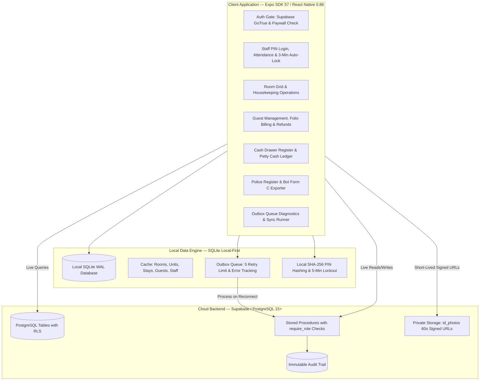

# LogStay Mobile — Master Architecture & Complete Reconstruction Manual

> **Document Type:** Production Engineering Blueprint & Complete Disaster Recovery Manual  
> **Platform:** React Native (Expo SDK 57 / Expo Router v57) & Supabase Cloud (PostgreSQL 15+)  
> **Version:** 3.0 (Production-Hardened: RBAC, Offline-First SQLite, Idempotent Financials, Compliance Exports, Subscriptions)  
> **Target Audience:** Developers, DevOps Engineers, System Architects, Hostel Owners

---

## 1. Executive Summary & Core Philosophy

**LogStay Mobile** is a mobile-first Property Management System (PMS) designed for hostels, guesthouses, and homestays. It is engineered to operate reliably in low-connectivity or zero-connectivity environments without sacrificing database security, strict financial ledger accountability, or regulatory compliance (Indian Bureau of Immigration Form C and Indian Police Register).



---

## 2. Complete Technology Stack & Package Inventory

| Package | Version | Purpose & Usage in Code |
| :--- | :---: | :--- |
| **`expo`** | `~57.0.27` | Application runtime, core native bridge, and Expo SDK foundation. |
| **`expo-router`** | `~57.0.25` | File-system-based navigation. All screens live in `src/app/`. |
| **`react` & `react-native`** | `19.2.3` / `0.86.3` | React 19 architecture with React Native core UI components. |
| **`@supabase/supabase-js`** | `^2.117.2` | Supabase JavaScript client for PostgreSQL database operations, RPCs, Auth, and Storage. |
| **`expo-sqlite`** | `~57.0.4` | High-performance local SQLite database (`logstay.db`) configured in Write-Ahead Logging (`WAL`) mode for local-first caching and outbox queues. |
| **`@react-native-community/netinfo`** | `12.0.1` | Network monitoring tool detecting online/offline transitions and triggering outbox syncs. |
| **`@react-native-async-storage/async-storage`** | `2.2.0` | Client key-value persistence for Supabase sessions and `activeStaff` context. |
| **`expo-crypto`** | `~57.0.3` | Generates cryptographic client-side UUIDs (`randomUUID()`) for idempotency and SHA-256 local PIN hashing (`digestStringAsync`). |
| **`expo-image-picker`** | `~57.0.20` | Native camera interface for photographing guest identity documents. |
| **`expo-image-manipulator`** | `~57.0.21` | In-memory image processing; scales ID photos to 1280px wide and compresses to 60% JPEG quality before storage. |
| **`expo-file-system`** | `~57.0.7` | File creation and manipulation (`File`, `Paths.cache`) for exporting CSV files and local backups. |
| **`expo-sharing`** | `~57.0.22` | Native OS share sheet integration allowing staff to send exported CSVs directly to police/immigration portals via WhatsApp, Drive, or Email. |
| **`expo-linking`** | `~57.0.12` | Deep-linking and external app launcher (used for direct WhatsApp support links in ErrorBoundary and Settings). |
| **`react-native-safe-area-context`** | `~5.7.0` | Edge-to-edge layout management handling notches, home indicators, and status bars. |
| **`react-native-screens`** | `~4.26.0` | Native view primitives powering smooth, hardware-accelerated navigation transitions. |
| **`react-native-url-polyfill`** | `^4.0.0` | URL standard polyfill required for Supabase Realtime and Auth on native devices. |

---

## 3. Directory & File Blueprint

```
LogStay-Mobile/
├── 001phase0.sql                 # Baseline schema: properties, members, rooms, units, stays
├── 002phase2.sql                 # Staff profiles, attendance, cash entries
├── 003phase3.sql                 # Housekeeping log, unit cleaning tracking, issue reporting
├── 004phase4.sql                 # Charges & folio purchases
├── 005phase5.sql                 # RBAC engine: require_role, staff_login with lockout, deactivation
├── 006phase5.sql                 # Secure RPC overrides: check_out_guest, record_payment
├── 007phase6money.sql            # Idempotent payments table, pay-later checkins
├── 0009.sql                      # Sprint 1: refund_payment RPC and paid_amount adjustments
├── 0010.sql                      # Sprint 2: property_invites table and 48-hour rotating code RPCs
├── package.json                  # Dependencies and scripts
├── app.json                      # Expo application metadata and configuration
├── tsconfig.json                 # TypeScript strict configuration
└── src/
    ├── lib/
    │   ├── supabase.ts           # Supabase client initialized with AsyncStorage
    │   ├── offline.ts            # Local SQLite schema, caching, outbox processor, local PIN hashing
    │   ├── permissions.ts        # RBAC capability matrix (owner, desk, housekeeping)
    │   ├── staff-context.tsx     # Context provider with 3-minute AppState auto-lock
    │   └── countries.ts          # ISO country dictionary with fast alias search
    └── app/
        ├── _layout.tsx           # Root navigation stack, paywall gate, ErrorBoundary, StaffProvider
        ├── login.tsx             # Supabase Owner authentication
        ├── setup-property.tsx    # Property creation and invite code joining
        ├── staff-login.tsx       # 4-digit staff PIN authentication with online/offline fallbacks
        ├── home.tsx              # Operations dashboard, bed grid, sync banner, staff switch
        ├── add-room.tsx          # Room and bed creator (private rooms vs dorms)
        ├── add-staff.tsx         # Staff onboarding with role assignment and PIN hashing
        ├── checkin.tsx           # Check-in flow: gender rules, ID capture, Pay-Later, Form C
        ├── checkout.tsx          # Check-out flow: balance verification modal, auto-dirty beds
        ├── guests.tsx            # In-house and past guests directory with instant local caching
        ├── guest/[id].tsx        # Guest folio: signed ID viewer, charges, payments, refund modal
        ├── room/[id].tsx         # Room detail: Overview & History tabs, housekeeping, issues
        ├── shift.tsx             # Shift register: drawer opening/closing, petty cash, co-sign PIN
        ├── exports.tsx           # Compliance exporter: Indian Police Register & BoI Form C CSVs
        ├── form-c.tsx            # Foreign guest compliance tracker
        ├── outbox.tsx            # Offline sync diagnostics: retry all, discard failed items
        ├── audit-log.tsx         # Owner audit trail viewer for high-security actions
        ├── settings.tsx          # Property settings, 48-hr invite code generator, CSV backup
        ├── privacy.tsx           # Privacy & Data Retention policy disclosure screen
        ├── paywall.tsx           # Subscription expiration lock screen
        └── ErrorBoundary.tsx     # Application crash recovery screen with WhatsApp support button
```

---

## 4. Deep-Dive File Breakdown

### Architecture & Utilities (`src/lib/`)

#### 1. `src/lib/supabase.ts`
- **Role:** Initializes the singleton Supabase client.
- **How it works:** Configures `@supabase/supabase-js` using environment variables `EXPO_PUBLIC_SUPABASE_URL` and `EXPO_PUBLIC_SUPABASE_ANON_KEY`. Injects `AsyncStorage` as the auth storage adapter with `autoRefreshToken: true` and `persistSession: true` to preserve user login across app restarts.

#### 2. `src/lib/permissions.ts`
- **Role:** Defines the client-side Role-Based Access Control (RBAC) permissions matrix.
- **Roles:** `'owner'`, `'desk'`, `'housekeeping'`.
- **Actions:** `'check_in'`, `'check_out'`, `'guests'`, `'shift'`, `'add_room'`, `'export'`, `'form_c'`, `'settings'`, `'mark_clean'`, `'set_maintenance'`, `'view_id_photo'`, `'refund_payment'`.
- **How it works:** Exports the `can(role, action): boolean` pure function, ensuring non-owner staff cannot access administrative screens or trigger unauthorized operations.

#### 3. `src/lib/staff-context.tsx`
- **Role:** Global React context managing the active staff session and workstation security.
- **Features:**
  - Persists the active staff session (`id`, `name`, `role`, `attendanceId`) in `AsyncStorage`.
  - Exposes `can(action)` helper to all connected UI screens.
  - **3-Minute Auto-Lock:** Monitors `AppState` change events. If the tablet is backgrounded or left inactive for more than 180 seconds, it clears the active staff session and redirects to `/staff-login`.

#### 4. `src/lib/offline.ts`
- **Role:** The core local-first persistence and synchronization engine.
- **Local SQLite Schema:**
  - `outbox`: `(id, entity, type, payload, created_at, status, attempts, last_error)`
  - `cache_rooms`, `cache_units`, `cache_stays`, `cache_guests`
  - `cache_staff`: `(id, name, role, active, pin_hash_local, salt, local_failed_tries, local_locked_until)`
- **Key Operations:**
  - `saveToOutbox(type, payload)`: Enqueues pending operations locally.
  - `processOutbox()`: Iterates pending queue items in FIFO order when online. Retries failed actions up to 5 times before marking them as `failed` with error diagnostics.
  - `saveLocalPinHash(staffId, pin)` & `verifyLocalPin(staffId, pin)`: Salts and hashes PINs with SHA-256 for secure offline authentication with a 5-minute local lockout after 5 consecutive bad tries.

---

### Application Screens (`src/app/`)

#### 1. `src/app/_layout.tsx`
- **Role:** Root application shell and global security guard.
- **How it works:**
  - Wraps the entire application inside `ErrorBoundary` and `StaffProvider`.
  - **Paywall Gate:** Inspects the authenticated property's `paid_until` date on cold boot. If missing or expired, replaces the navigation stack with `PaywallScreen`.
  - Defines Expo Router stack screens with `headerShown: false`.

#### 2. `src/app/staff-login.tsx`
- **Role:** Workstation lock screen for staff PIN authentication.
- **How it works:**
  - Displays avatar cards for active property staff members.
  - Validates 4-digit PIN against `staff_login` RPC (bcrypt verification on PostgreSQL).
  - Handles server-side lockout (5-minute lock after 5 bad tries).
  - **Offline Fallback:** If offline, invokes `verifyLocalPin` against SQLite cache.
  - Clocks in attendance via `staff_attendance` and records clock-in time.

#### 3. `src/app/home.tsx`
- **Role:** Central operations dashboard.
- **How it works:**
  - Displays real-time bed occupancy grid (Clean, Dirty, Occupied, Maintenance).
  - Implements 1-tap "Quick Clean" action stamped with `activeStaff.id`.
  - Displays "On Duty" staff header with duty start timestamp and "Switch Staff" button.
  - Interactive `⚠️ Pending Sync` banner displaying offline queue counts and navigating to `/outbox`.
  - Role-guarded action grid (Check-In, Check-Out, Shift, Compliance, Settings).

#### 4. `src/app/checkin.tsx`
- **Role:** Complete guest onboarding flow.
- **Key Features:**
  - **Dorm Gender Rule Enforcement:** Checks unit's `gender_rule` against guest gender. Blocks desk staff if mismatched, allows owner override with confirmation modal.
  - **Camera & Compression:** Captures ID document and compresses to 1280px wide / 60% quality (~200KB).
  - **Pay Later Support:** Allows checking in with ₹0 paid or partial payments without requiring an open cash shift.
  - **Form C Integration:** Collects passport, visa, arrival port, and destination if guest is non-Indian.
  - **Atomic RPC:** Calls `check_in_guest` RPC (guest, stay, cash collection, and foreign details in one transaction). Enqueues to outbox if offline.

#### 5. `src/app/checkout.tsx`
- **Role:** Guest departure and bed turnover flow.
- **How it works:**
  - Lists all currently checked-in guests.
  - **Balance Due Blocker:** Calculates `(stay.amount + charges) - paid_amount`. If balance is greater than 0, blocks check-out and presents a prompt to collect payment or route to the folio.
  - Invokes `check_out_guest` RPC to mark stay `checked_out`, automatically turns the bed `dirty`, and stamps the action with `staff_id`.

#### 6. `src/app/guest/[id].tsx`
- **Role:** Complete folio ledger, purchases, and guest identity screen.
- **Key Features:**
  - **Signed ID Photo Viewer:** Generates a 60-second expiring signed URL from private `id_photos` bucket and logs every view in `audit_log`.
  - **Retention Policy UI:** Displays auto-deletion date (`id_photo_expires_at`) or policy deletion message if `id_deleted_at` is set.
  - **Add Purchases:** Folio billing sheet for adding purchases (tea, water, laundry, tours).
  - **Payments & Refunds:** Lists payment history with pay mode and timestamp. Allows owners to refund individual payments via `refund_payment` RPC, deducting cash from the active shift drawer with a mandatory reason.

#### 7. `src/app/room/[id].tsx`
- **Role:** Detailed bed/room management screen.
- **Features:**
  - **Overview Tab:** Shows current guest, bed status, last cleaned timestamp, and open issues.
  - **History Tab:** Timeline of past guest stays, cleaning logs, and resolved maintenance issues.
  - **Issue Reporting:** Modal to report room issues (AC, plumbing, noise, cleanliness).

#### 8. `src/app/shift.tsx`
- **Role:** Cash drawer accounting and shift handover register.
- **How it works:**
  - Opens shift with starting float amount.
  - Tracks expected cash: `Opening Float + Cash Collections - Petty Cash - Refunds`.
  - Logs petty cash expenses with note and staff stamp.
  - Closes shift with dual co-sign PIN verification, calculating drawer surplus or deficit.

#### 9. `src/app/exports.tsx`
- **Role:** Regulatory compliance export generator.
- **Features:**
  - **Indian Police Register CSV:** Generates standard register format with masked ID numbers (`****${id_last4}`) for privacy compliance.
  - **BoI Form C Bulk CSV:** Exports exact Bureau of Immigration portal schema (Given Name, Surname, Nationality, Passport No, Visa Type/No, Duration of Stay, Address in India).
  - Saves file locally to `Paths.cache` and opens native OS sharing sheet via `expo-sharing`.

#### 10. `src/app/outbox.tsx`
- **Role:** Offline synchronization diagnostics and queue monitor.
- **Features:**
  - Lists pending and failed queue items with payload snippets, timestamps, attempt counters (`attempts/5`), and error messages.
  - "Retry All" trigger calling `processOutbox()`.
  - "Discard Failed Item" button for owners to remove corrupted actions.

#### 11. `src/app/settings.tsx`
- **Role:** Property management and owner controls.
- **Features:**
  - **48-Hour Rotating Invite Codes:** Generates secure temporary 6-character alphanumeric codes via `generate_invite_code` RPC.
  - **Staff Management:** Lists team members, allows owner to reset PINs or deactivate staff with reason.
  - **Audit Trail Link:** Route to `audit-log.tsx` (Owner only).
  - **Data Backup:** Generates and shares a complete CSV backup of all guest records.

#### 12. `src/app/audit-log.tsx`
- **Role:** Immutable audit trail screen (Owner only).
- **How it works:** Queries `audit_log` table ordered by `created_at DESC` to review sensitive actions (ID photo views, staff deactivations, PIN resets, refunds).

#### 13. `src/app/paywall.tsx`
- **Role:** Subscription expiration screen blocking access when `paid_until` date has passed.

#### 14. `src/app/privacy.tsx`
- **Role:** Data retention and privacy policy disclosure informing staff and guests about DPDP compliance and 6-month automated ID photo purging.

---

## 5. Complete Database Schema & Migration Sequence

Execute these SQL files in order against Supabase to reconstruct the backend from scratch:

### 1. `001phase0.sql` (Core Schema & Storage)
```sql
-- Extensions
CREATE EXTENSION IF NOT EXISTS "uuid-ossp";
CREATE EXTENSION IF NOT EXISTS "pgcrypto";

-- Properties Table
CREATE TABLE properties (
  id uuid PRIMARY KEY DEFAULT gen_random_uuid(),
  name text NOT NULL,
  address text,
  paid_until timestamptz DEFAULT (now() + interval '30 days'),
  created_at timestamptz DEFAULT now()
);

-- Members (Auth Link)
CREATE TABLE members (
  id uuid PRIMARY KEY DEFAULT gen_random_uuid(),
  property_id uuid REFERENCES properties(id) ON DELETE CASCADE NOT NULL,
  user_id uuid REFERENCES auth.users(id) ON DELETE CASCADE NOT NULL,
  role text DEFAULT 'owner',
  created_at timestamptz DEFAULT now()
);

-- Rooms and Units (Beds)
CREATE TABLE rooms (
  id uuid PRIMARY KEY DEFAULT gen_random_uuid(),
  property_id uuid REFERENCES properties(id) ON DELETE CASCADE NOT NULL,
  label text NOT NULL,
  kind text NOT NULL CHECK (kind IN ('private', 'dorm')),
  created_at timestamptz DEFAULT now()
);

CREATE TABLE units (
  id uuid PRIMARY KEY DEFAULT gen_random_uuid(),
  room_id uuid REFERENCES rooms(id) ON DELETE CASCADE NOT NULL,
  label text NOT NULL,
  gender_rule text DEFAULT 'any' CHECK (gender_rule IN ('any', 'male', 'female')),
  housekeeping_status text DEFAULT 'clean' CHECK (housekeeping_status IN ('clean', 'dirty', 'maintenance')),
  last_cleaned_at timestamptz,
  last_cleaned_by uuid,
  created_at timestamptz DEFAULT now()
);

-- Guests & Stays
CREATE TABLE guests (
  id uuid PRIMARY KEY DEFAULT gen_random_uuid(),
  property_id uuid REFERENCES properties(id) ON DELETE CASCADE NOT NULL,
  name text NOT NULL,
  phone text,
  nationality text NOT NULL,
  gender text CHECK (gender IN ('male', 'female', 'other')),
  id_type text NOT NULL,
  id_last4 text NOT NULL,
  id_photo_path text,
  id_photo_expires_at timestamptz DEFAULT (now() + interval '6 months'),
  id_deleted_at timestamptz,
  created_at timestamptz DEFAULT now()
);

CREATE TABLE stays (
  id uuid PRIMARY KEY DEFAULT gen_random_uuid(),
  property_id uuid REFERENCES properties(id) ON DELETE CASCADE NOT NULL,
  guest_id uuid REFERENCES guests(id) ON DELETE RESTRICT NOT NULL,
  unit_id uuid REFERENCES units(id) ON DELETE RESTRICT NOT NULL,
  check_in timestamptz DEFAULT now() NOT NULL,
  check_out timestamptz,
  status text DEFAULT 'checked_in' CHECK (status IN ('checked_in', 'checked_out', 'cancelled')),
  amount numeric(10,2) DEFAULT 0,
  paid_amount numeric(10,2) DEFAULT 0,
  pay_mode text CHECK (pay_mode IN ('cash', 'upi')),
  staff_id uuid,
  created_at timestamptz DEFAULT now()
);

-- Foreign Travelers (Form C)
CREATE TABLE foreign_details (
  stay_id uuid PRIMARY KEY REFERENCES stays(id) ON DELETE CASCADE,
  passport_no text NOT NULL,
  visa_no text,
  visa_type text,
  arrived_from text,
  next_dest text,
  form_c_filed boolean DEFAULT false,
  created_at timestamptz DEFAULT now()
);

-- RLS Helper
CREATE OR REPLACE FUNCTION is_member(p uuid) RETURNS boolean
LANGUAGE sql SECURITY DEFINER STABLE SET search_path = public AS
$$ SELECT EXISTS (SELECT 1 FROM members WHERE property_id = p AND user_id = auth.uid()) $$;

-- Enable RLS
ALTER TABLE properties ENABLE ROW LEVEL SECURITY;
ALTER TABLE members ENABLE ROW LEVEL SECURITY;
ALTER TABLE rooms ENABLE ROW LEVEL SECURITY;
ALTER TABLE units ENABLE ROW LEVEL SECURITY;
ALTER TABLE guests ENABLE ROW LEVEL SECURITY;
ALTER TABLE stays ENABLE ROW LEVEL SECURITY;
ALTER TABLE foreign_details ENABLE ROW LEVEL SECURITY;

CREATE POLICY "properties read" ON properties FOR SELECT USING (is_member(id));
CREATE POLICY "members read" ON members FOR SELECT USING (is_member(property_id));
CREATE POLICY "rooms rw" ON rooms FOR ALL USING (is_member(property_id)) WITH CHECK (is_member(property_id));
CREATE POLICY "units rw" ON units FOR ALL USING (EXISTS (SELECT 1 FROM rooms r WHERE r.id = room_id AND is_member(r.property_id)));
CREATE POLICY "guests rw" ON guests FOR ALL USING (is_member(property_id)) WITH CHECK (is_member(property_id));
CREATE POLICY "stays rw" ON stays FOR ALL USING (is_member(property_id)) WITH CHECK (is_member(property_id));
CREATE POLICY "foreign_details rw" ON foreign_details FOR ALL USING (EXISTS (SELECT 1 FROM stays s WHERE s.id = stay_id AND is_member(s.property_id)));

-- Private Storage Bucket
INSERT INTO storage.buckets (id, name, public) VALUES ('id_photos', 'id_photos', false)
ON CONFLICT (id) DO UPDATE SET public = false;

CREATE POLICY "id_photos member access" ON storage.objects FOR ALL
USING (bucket_id = 'id_photos' AND is_member((storage.foldername(name))[1]::uuid))
WITH CHECK (bucket_id = 'id_photos' AND is_member((storage.foldername(name))[1]::uuid));
```

### 2. `002phase2.sql` through `004phase4.sql` (Operations & Folios)
```sql
-- Staff Profiles & Attendance
CREATE TABLE staff_profiles (
  id uuid PRIMARY KEY DEFAULT gen_random_uuid(),
  property_id uuid REFERENCES properties(id) ON DELETE CASCADE NOT NULL,
  name text NOT NULL,
  phone text,
  role text NOT NULL CHECK (role IN ('owner', 'desk', 'housekeeping')),
  pin_hash text NOT NULL,
  active boolean DEFAULT true,
  joined_on date DEFAULT current_date
);

CREATE TABLE staff_attendance (
  id uuid PRIMARY KEY DEFAULT gen_random_uuid(),
  staff_id uuid REFERENCES staff_profiles(id) ON DELETE CASCADE NOT NULL,
  clock_in timestamptz DEFAULT now(),
  clock_out timestamptz
);

-- Shifts & Cash Entries
CREATE TABLE shifts (
  id uuid PRIMARY KEY DEFAULT gen_random_uuid(),
  property_id uuid REFERENCES properties(id) ON DELETE CASCADE NOT NULL,
  opened_by uuid REFERENCES auth.users(id),
  opening_cash numeric(10,2) NOT NULL,
  closed_at timestamptz,
  closing_cash numeric(10,2),
  status text DEFAULT 'open' CHECK (status IN ('open', 'closed')),
  created_at timestamptz DEFAULT now()
);

CREATE TABLE cash_entries (
  id uuid PRIMARY KEY DEFAULT gen_random_uuid(),
  shift_id uuid REFERENCES shifts(id) ON DELETE CASCADE NOT NULL,
  kind text NOT NULL CHECK (kind IN ('collection', 'petty', 'refund')),
  amount numeric(10,2) NOT NULL,
  note text,
  staff_id uuid REFERENCES staff_profiles(id),
  created_at timestamptz DEFAULT now()
);

-- Housekeeping Log & Issues
CREATE TABLE housekeeping_log (
  id uuid PRIMARY KEY DEFAULT gen_random_uuid(),
  property_id uuid REFERENCES properties(id) ON DELETE CASCADE NOT NULL,
  unit_id uuid REFERENCES units(id) ON DELETE CASCADE NOT NULL,
  status text NOT NULL,
  staff_id uuid REFERENCES staff_profiles(id),
  created_at timestamptz DEFAULT now()
);

CREATE TABLE issues (
  id uuid PRIMARY KEY DEFAULT gen_random_uuid(),
  property_id uuid REFERENCES properties(id) ON DELETE CASCADE NOT NULL,
  unit_id uuid REFERENCES units(id) ON DELETE CASCADE,
  stay_id uuid REFERENCES stays(id) ON DELETE SET NULL,
  category text NOT NULL,
  note text NOT NULL,
  status text DEFAULT 'open' CHECK (status IN ('open', 'resolved')),
  reported_by uuid,
  resolved_by uuid,
  resolved_at timestamptz,
  created_at timestamptz DEFAULT now()
);

-- Folio Charges
CREATE TABLE charges (
  id uuid PRIMARY KEY DEFAULT gen_random_uuid(),
  property_id uuid REFERENCES properties(id) ON DELETE CASCADE NOT NULL,
  stay_id uuid REFERENCES stays(id) ON DELETE CASCADE NOT NULL,
  item text NOT NULL,
  qty int DEFAULT 1,
  unit_price numeric(10,2) NOT NULL,
  paid boolean DEFAULT false,
  pay_mode text CHECK (pay_mode IN ('cash', 'upi')),
  staff_id uuid REFERENCES staff_profiles(id),
  created_at timestamptz DEFAULT now()
);
```

### 3. `005phase5.sql` & `006phase5.sql` (RBAC Security Core)
```sql
-- RBAC Helper Functions
CREATE OR REPLACE FUNCTION staff_role(p_prop uuid, p_staff uuid) RETURNS text
LANGUAGE sql SECURITY DEFINER STABLE SET search_path = public AS
$$ SELECT role FROM staff_profiles WHERE id = p_staff AND property_id = p_prop AND active $$;

CREATE OR REPLACE FUNCTION require_role(p_prop uuid, p_staff uuid, p_roles text[]) RETURNS void
LANGUAGE plpgsql SECURITY DEFINER SET search_path = public AS $$
BEGIN
  IF NOT is_member(p_prop) THEN RAISE EXCEPTION 'Not a member'; END IF;
  IF NOT coalesce(staff_role(p_prop, p_staff) = ANY(p_roles), false) THEN
    RAISE EXCEPTION 'Not allowed for this role';
  END IF;
END $$;

-- PIN Login with 5-Minute Lockout
ALTER TABLE staff_profiles
  ADD COLUMN IF NOT EXISTS failed_tries int DEFAULT 0,
  ADD COLUMN IF NOT EXISTS locked_until timestamptz,
  ADD COLUMN IF NOT EXISTS deactivated_at timestamptz,
  ADD COLUMN IF NOT EXISTS deactivated_by uuid;

CREATE OR REPLACE FUNCTION staff_login(p_staff uuid, p_pin text) RETURNS boolean
LANGUAGE plpgsql SECURITY DEFINER SET search_path = public, extensions AS $$
DECLARE s staff_profiles%rowtype;
BEGIN
  SELECT * INTO s FROM staff_profiles WHERE id = p_staff AND active;
  IF NOT FOUND OR NOT is_member(s.property_id) THEN RETURN false; END IF;
  IF s.locked_until > now() THEN RAISE EXCEPTION 'Locked, try later'; END IF;
  
  IF s.pin_hash = crypt(p_pin, s.pin_hash) THEN
    UPDATE staff_profiles SET failed_tries = 0, locked_until = null WHERE id = p_staff;
    RETURN true;
  END IF;

  UPDATE staff_profiles 
  SET failed_tries = failed_tries + 1,
      locked_until = CASE WHEN failed_tries + 1 >= 5 THEN now() + interval '5 minutes' END
  WHERE id = p_staff;
  RETURN false;
END $$;

-- Owner Add Staff with First-Owner Bootstrap
CREATE OR REPLACE FUNCTION owner_add_staff(
  p_prop uuid, p_actor uuid, p_name text, p_phone text, p_role text, p_pin text
) RETURNS uuid
LANGUAGE plpgsql SECURITY DEFINER SET search_path = public, extensions AS $$
DECLARE
  v_new_id uuid := gen_random_uuid();
  v_is_first boolean;
BEGIN
  SELECT NOT EXISTS (SELECT 1 FROM staff_profiles WHERE property_id = p_prop AND role = 'owner' AND active) INTO v_is_first;
  IF NOT v_is_first THEN
    PERFORM require_role(p_prop, p_actor, array['owner']);
  END IF;
  
  INSERT INTO staff_profiles (id, property_id, name, phone, role, pin_hash)
  VALUES (v_new_id, p_prop, p_name, p_phone, p_role, crypt(p_pin, gen_salt('bf')));
  RETURN v_new_id;
END;
$$;

-- Audit Log Table
CREATE TABLE IF NOT EXISTS audit_log (
  id uuid PRIMARY KEY DEFAULT gen_random_uuid(),
  property_id uuid REFERENCES properties(id) ON DELETE CASCADE NOT NULL,
  user_id uuid REFERENCES auth.users(id),
  staff_id uuid REFERENCES staff_profiles(id),
  action text NOT NULL,
  record_id uuid,
  created_at timestamptz DEFAULT now()
);

ALTER TABLE audit_log ENABLE ROW LEVEL SECURITY;
REVOKE UPDATE, DELETE ON audit_log FROM authenticated;
CREATE POLICY "audit_ins" ON audit_log FOR INSERT TO authenticated WITH CHECK (is_member(property_id));
CREATE POLICY "audit_sel" ON audit_log FOR SELECT TO authenticated USING (is_member(property_id));
```

### 4. `007phase6money.sql` (Idempotent Financial Ledger)
```sql
CREATE TABLE IF NOT EXISTS payments (
  id uuid PRIMARY KEY, -- Client-generated UUID
  property_id uuid REFERENCES properties(id) ON DELETE CASCADE NOT NULL,
  stay_id uuid REFERENCES stays(id) ON DELETE CASCADE NOT NULL,
  amount numeric(10,2) NOT NULL CHECK (amount > 0),
  pay_mode text CHECK (pay_mode IN ('cash', 'upi')),
  shift_id uuid REFERENCES shifts(id),
  staff_id uuid REFERENCES staff_profiles(id),
  refunded boolean DEFAULT false,
  created_at timestamptz DEFAULT now()
);

ALTER TABLE payments ENABLE ROW LEVEL SECURITY;
CREATE POLICY "payments rw" ON payments FOR ALL USING (is_member(property_id)) WITH CHECK (is_member(property_id));

-- Idempotent Payment RPC
CREATE OR REPLACE FUNCTION record_payment(
  p_payment_id uuid, p_stay_id uuid, p_amount numeric, p_pay_mode text, p_staff_id uuid
) RETURNS void
LANGUAGE plpgsql SECURITY DEFINER SET search_path = public, extensions AS $$
DECLARE
  v_property_id uuid;
  v_open_shift_id uuid;
BEGIN
  IF EXISTS (SELECT 1 FROM payments WHERE id = p_payment_id) THEN RETURN; END IF;

  SELECT property_id INTO v_property_id FROM stays WHERE id = p_stay_id;
  IF NOT FOUND THEN RAISE EXCEPTION 'Stay not found'; END IF;
  
  PERFORM require_role(v_property_id, p_staff_id, array['owner', 'desk']);

  INSERT INTO payments (id, property_id, stay_id, amount, pay_mode, staff_id)
  VALUES (p_payment_id, v_property_id, p_stay_id, p_amount, p_pay_mode, p_staff_id);

  IF p_pay_mode = 'cash' THEN
    SELECT id INTO v_open_shift_id FROM shifts WHERE property_id = v_property_id AND status = 'open' LIMIT 1;
    IF v_open_shift_id IS NULL THEN RAISE EXCEPTION 'Cannot collect cash without an open shift'; END IF;
    
    UPDATE payments SET shift_id = v_open_shift_id WHERE id = p_payment_id;
    INSERT INTO cash_entries (id, shift_id, kind, amount, note, staff_id)
    VALUES (p_payment_id, v_open_shift_id, 'collection', p_amount, 'Payment on Folio', p_staff_id);
  END IF;

  UPDATE stays SET paid_amount = coalesce(paid_amount, 0) + p_amount WHERE id = p_stay_id;
END;
$$;
```

### 5. `0009.sql` & `0010.sql` (Refunds & Rotating Invites)
```sql
-- Refund Payment (Owner Only)
CREATE OR REPLACE FUNCTION refund_payment(p_payment_id uuid, p_staff_id uuid, p_reason text)
RETURNS void
LANGUAGE plpgsql SECURITY DEFINER SET search_path = public, extensions AS $$
DECLARE
  v_payment payments%rowtype;
  v_property_id uuid;
  v_open_shift_id uuid;
BEGIN
  SELECT * INTO v_payment FROM payments WHERE id = p_payment_id;
  IF NOT FOUND THEN RAISE EXCEPTION 'Payment not found'; END IF;
  IF v_payment.refunded THEN RAISE EXCEPTION 'Already refunded'; END IF;
  
  v_property_id := v_payment.property_id;
  PERFORM require_role(v_property_id, p_staff_id, array['owner']);

  UPDATE payments SET refunded = true WHERE id = p_payment_id;

  IF v_payment.pay_mode = 'cash' THEN
    SELECT id INTO v_open_shift_id FROM shifts WHERE property_id = v_property_id AND status = 'open' LIMIT 1;
    IF v_open_shift_id IS NULL THEN RAISE EXCEPTION 'Cannot refund cash without an open shift'; END IF;
    
    INSERT INTO cash_entries (id, shift_id, kind, amount, note, staff_id)
    VALUES (gen_random_uuid(), v_open_shift_id, 'refund', v_payment.amount, 'Refund: ' || p_reason, p_staff_id);
  END IF;

  UPDATE stays SET paid_amount = GREATEST(0, paid_amount - v_payment.amount) WHERE id = v_payment.stay_id;
END;
$$;

-- 48-Hour Rotating Invites
CREATE TABLE IF NOT EXISTS property_invites (
  id uuid PRIMARY KEY DEFAULT gen_random_uuid(),
  property_id uuid REFERENCES properties(id) ON DELETE CASCADE NOT NULL,
  code text NOT NULL,
  expires_at timestamptz NOT NULL,
  created_by uuid REFERENCES auth.users(id),
  created_at timestamptz DEFAULT now()
);

ALTER TABLE property_invites ENABLE ROW LEVEL SECURITY;
CREATE POLICY "invites rw" ON property_invites FOR ALL USING (is_member(property_id)) WITH CHECK (is_member(property_id));

CREATE OR REPLACE FUNCTION generate_invite_code(p_prop uuid, p_actor uuid)
RETURNS text
LANGUAGE plpgsql SECURITY DEFINER SET search_path = public, extensions AS $$
DECLARE
  v_code text;
  v_chars text := 'ABCDEFGHJKLMNPQRSTUVWXYZ23456789';
BEGIN
  PERFORM require_role(p_prop, p_actor, array['owner']);
  
  v_code := '';
  FOR i IN 1..6 LOOP
    v_code := v_code || substr(v_chars, floor(random() * length(v_chars))::int + 1, 1);
  END LOOP;
  
  INSERT INTO property_invites (property_id, code, expires_at, created_by)
  VALUES (p_prop, v_code, now() + interval '48 hours', auth.uid());
  
  RETURN v_code;
END;
$$;
```

---

## 6. Complete Disaster Recovery & Reconstruction Guide

If this project is ever lost, follow this exact step-by-step procedure to reconstruct and launch it from a clean slate:

### Step 1: Initialize New Expo Project
```bash
npx create-expo-app@latest LogStay-Mobile --template blank-typescript
cd LogStay-Mobile
```

### Step 2: Install Verified SDK 57 Dependencies
Run this exact command to install compatible versions:
```bash
npx expo install @expo/vector-icons @react-native-async-storage/async-storage @react-native-community/netinfo @supabase/supabase-js expo-constants expo-crypto expo-device expo-file-system expo-font expo-image expo-image-manipulator expo-image-picker expo-linking expo-router expo-secure-store expo-sharing expo-splash-screen expo-sqlite expo-status-bar expo-symbols expo-system-ui expo-web-browser react-native-gesture-handler react-native-reanimated react-native-safe-area-context react-native-screens react-native-url-polyfill zod
```

### Step 3: Configure Environment Variables
Create `.env` in the project root:
```env
EXPO_PUBLIC_SUPABASE_URL=https://your-project.supabase.co
EXPO_PUBLIC_SUPABASE_ANON_KEY=your-anon-key-here
```

### Step 4: Apply Database Migrations
In the Supabase SQL Editor, execute the SQL migration scripts in sequence (`001` through `0010`).

### Step 5: Restore Application Code
Restore the file tree detailed in Section 3 and Section 4.

### Step 6: Verify Build & Compile
```bash
npx expo install --fix   # Verify dependency tree
npx tsc --noEmit         # Typecheck
npx expo lint            # Lint check
npx expo start           # Launch local dev server
```
